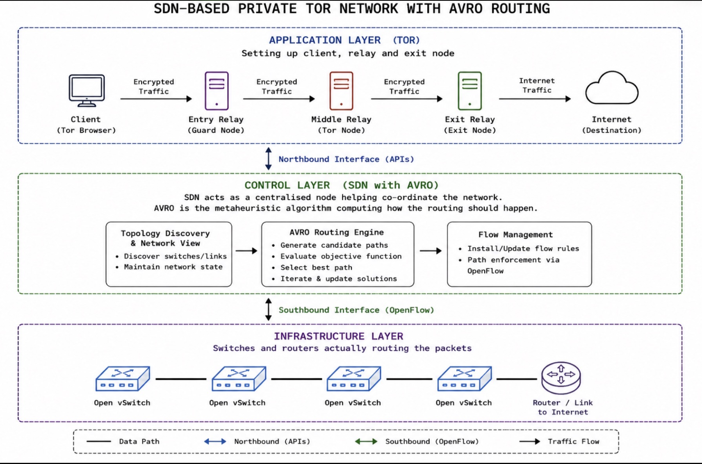

# SDN-Controlled Private Tor Network with AVRO Routing

A proof-of-concept integrating a simplified **African Vulture Optimization Algorithm (`MiniAVOA`)** into an **OSKen-based Software Defined Network (SDN)** to generate candidate edge-weight vectors and compute layer-3 forwarding paths across an isolated private Tor testbed.

---

## Architecture

*(Note: The diagram illustrates the conceptual three-tier Tor-SDN architecture. In the deployed testbed, the overlay consists of four containerized Tor nodes operating without external Internet access.)*

The system separates control logic, packet forwarding, and overlay routing across three tiers:

- **Application Layer (Tor Overlay):** Private, isolated Tor deployment comprising four container instances: one Tor client (`tor_cli`), one combined relay and directory authority (`tor_relay`), one secondary relay (`tor_relay2`), and one hidden-service directory relay (`tor_hsdir`).
- **Control Layer (OSKen Controller with `MiniAVOA`):** Centralized OpenFlow 1.3 control plane that discovers the Spine-Leaf topology, generates candidate edge-weight vectors using a simplified AVOA-inspired metaheuristic, resolves minimum-total-weight paths via Dijkstra's algorithm, and installs forwarding rules.
- **Infrastructure Layer (Data Plane):** Seven Open vSwitch (OVS) instances arranged in a Spine-Leaf fabric (`s1`–`s3` spine, `s4`–`s7` leaf) that forward encapsulated onion-routed packets based on active flow table entries.

---

## Key Features

- **Private Tor Deployment:** Self-contained, isolated onion-routing testbed running without connectivity to the public Tor network.
- **Programmable Control Plane:** Built on the OSKen OpenFlow 1.3 controller framework.
- **Metaheuristic Weight Generation:** Generates candidate edge-weight vectors using a simplified AVOA-inspired metaheuristic (`MiniAVOA`) prior to shortest-path calculation.
- **Separation of Concerns:** Computes layer-3 switch forwarding paths using generated weights without decrypting Tor cells or controlling Tor's application-layer circuit construction.
- **Containerized Emulation:** Reproducible virtual topology orchestration built with Containernet, Docker, and Open vSwitch.

---

## Technologies Used

- **Network Control & Emulation:** [OSKen](https://github.com/os-ken/os-ken) (OpenFlow 1.3 Controller), [Containernet](https://github.com/containernet/containernet), [Mininet](http://mininet.org/), [Open vSwitch](https://www.openvswitch.org/).
- **Privacy & Overlay Routing:** [Tor](https://www.torproject.org/) (Containerized private directory authority, relays, HSDir, and client).
- **Graph & Numerical Computation:** [Python 3](https://www.python.org/), [NetworkX](https://networkx.org/) (Topology graphs & Dijkstra shortest path), [NumPy](https://numpy.org/) (Vector operations and statistical fitness distribution evaluation).
- **Virtualization & Host Environment:** [Docker Engine](https://www.docker.com/), Ubuntu Linux.

---

## Routing Methodology (Overview)

The controller computes minimum-total-weight paths using generated edge weights and installs the resulting forwarding rules across the OpenFlow switches. The weights are not currently derived from live network telemetry.

The current implementation uses a synthetic fitness function, minimizing the mean and standard deviation of candidate edge weights. This encourages low and relatively uniform edge costs, but does not directly optimize network congestion, link utilization, throughput, or latency. The generated weights are subsequently applied to the network graph, and NetworkX computes the minimum-total-weight path using Dijkstra's algorithm.

1. **Topology Ingestion:** The controller models the discovered Spine-Leaf switches and links as an undirected graph using NetworkX.
2. **Population-Based Search:** A population of candidate edge-weight vectors is initialized within bounded limits (`[1.0, 20.0]`).
3. **Fitness Calculation:** Candidates are evaluated using a synthetic objective function summing population standard deviation and mean ($\sigma + \mu$).
4. **Adaptive Phase Shift:** An exploration/exploitation decay factor controls whether candidate vectors search broader weight configurations or refine around the best-scoring vector.
5. **Flow Rule Installation:** The selected weight vector is mapped onto the NetworkX graph, minimum-total-weight paths are calculated via Dijkstra's algorithm, and corresponding OpenFlow `flow_mod` entries are pushed to OVS switches.

For detailed pseudocode, fitness definitions, and parameter comparisons with literature, see the [Routing Methodology Explanation](docs/explanation/routing-methodology.md).

---

## Current Limitations

- **Synthetic Metric Optimization:** Candidate fitness is currently computed over internal statistical representations of the link weights rather than dynamic OpenFlow port counters (`OFPPortStatsReply`).
- **Static Graph State:** Does not account for sudden runtime link failures (flapping) or external cross-traffic injection.
- **Unified Exploitation Branch:** Uses a simplified single-branch exploitation phase rather than the full two-tier siege attack mechanism described in foundational AVOA literature.
- **Relay Bootstrap Ceiling (~85%):** Only `tor_cli` reaches `100%` bootstrap; the three relay containers stall around `85%` because relays exclude themselves when building verification circuits, though client-initiated encrypted circuits complete normally.
---

## Documentation

Comprehensive guides and technical documentation are organized using the Diátaxis framework:

### Tutorials
- [**Getting Started**](docs/tutorials/getting-started.md) — Step-by-step walkthrough to set up dependencies and run your first emulated SDN-Tor session from scratch.

### How-to Guides
- [**Run the Tor Network**](docs/how-to/run-tor-network.md) — Practical guide to initializing directory authorities, verifying relay handshakes, and testing circuit creation.
- [**Launch the SDN Controller**](docs/how-to/launch-controller.md) — How to configure, boot, and inspect the OSKen application and verify OpenFlow 1.3 socket bindings.
- [**Change Network Topology**](docs/how-to/change-topology.md) — How to configure and change the topology. 
### Explanation
- [**System Architecture**](docs/explanation/architecture.md) — Deep architectural dive into the interaction between the application, control, and infrastructure planes.
- [**Routing Methodology**](docs/explanation/routing-methodology.md) — Theoretical background, mathematical motivation, and comparison of metaheuristics versus machine learning in SDN environments
- [**Tor Integration**](docs/explanation/tor-integration.md)  — How the Tor is configured and works in the project.

---

## Future Work

- **Live Telemetry Ingestion:** Connect the optimization engine to dynamic OpenFlow telemetry metrics (live queue occupancy, port loss, and transit delay counters).
- **Bifurcated Exploitation:** Implement the full two-stage coordinated siege attack logic from Chen et al. (2024).
- **Empirical Benchmarking:** Measure end-to-end circuit latency and packet delivery ratios against baseline OpenFlow shortest-path routing and Equal-Cost Multi-Path (ECMP).
- **Dynamic Failure Recovery:** Automate fast-reroute OpenFlow table failover on switch link-down events.

---

## References

1. **ITor-SDN Framework:**  
   F. A. Yaseen, N. A. Alkhalidi, and H. S. Al-Raweshidy, *"ITor-SDN: Intelligent Tor Networks-Based SDN for Data Forwarding Management,"* IEEE Systems Journal.
2. **AVOA Dynamic Routing Foundation:**  
   Chen, J., Xiao, W., Zhang, H., Zuo, J., & Li, X. (2024). *"Dynamic routing optimization in software-defined networking based on a metaheuristic algorithm."* *Journal of Cloud Computing*, 13. [DOI: 10.1186/s13677-024-00603-1](https://doi.org/10.1186/s13677-024-00603-1).
3. **Original AVOA Formulation:**  
   Abdollahzadeh, B., Gharehchopogh, F. S., & Mirjalili, S. (2021). *"African vultures optimization algorithm: A new nature-inspired metaheuristic technology for global optimization problems."* *Computers & Industrial Engineering*, 158, 107408.

