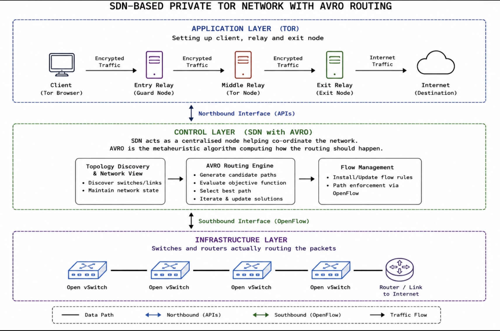

# SDN-Controlled Private Tor Network with AVRO Routing

A proof-of-concept integrating the **African Vulture Optimization Algorithm (AVOA / AVRO)** into an **OSKen-based Software Defined Network (SDN)** to dynamically optimize overlay routing for a private Tor network.

---

## Table of Contents
* [Overview & Motivation](#overview--motivation)
* [System Architecture](#system-architecture)
* [Prerequisites & Environment](#prerequisites--environment)
* [Getting Started](#getting-started)
* [Routing Methodology (MiniAVOA)](#routing-methodology-miniavoa)
* [Known Limitations](#known-limitations)
* [Roadmap](#roadmap)
* [References](#references)

---

## Overview & Motivation

Tor’s onion routing provides anonymity through multi-hop cryptographic encapsulation, but introduces noticeable network latency. This project investigates whether a **lightweight metaheuristic optimization algorithm** can dynamically manage underlying layer-3 paths without altering Tor's application-layer anonymity guarantees.

### Key Objectives
* Deploy an isolated multi-relay private Tor topology in Containernet.
* Manage data-plane forwarding centrally using OpenFlow 1.3 via the OSKen controller.
* Implement an adaptive metaheuristic path-selection engine inspired by the African Vulture Optimization Algorithm (`MiniAVOA`).
* Balance network edge weights to prevent bottleneck formation across relay circuits.

---

## System Architecture



The platform is structured into three discrete layers:

* **Application Layer (Tor Overlay):** Fully contained private Tor deployment comprising directory authorities, entry (guard) nodes, middle relays, exit relays, and client instances running inside isolated Docker containers.
* **Control Layer (OSKen Controller with AVRO Engine):** Centralized control plane responsible for network topology discovery, state tracking, candidate weight optimization via `MiniAVOA`, and automated OpenFlow table rule calculation.
* **Infrastructure Layer (Data Plane):** Open vSwitch (OVS) nodes that switch encapsulated Tor cell traffic based on flows provisioned by the controller over standard OpenFlow v1.3 interfaces.

---

## Prerequisites & Environment

### Host System Requirements
* **Operating System:** Ubuntu 20.04 / 22.04 LTS
* **Virtualization & Container Runtime:** Docker Engine (`docker-ce`)
* **Network Emulation:** [Containernet](https://github.com/containernet/containernet)
* **Virtual Switching:** Open vSwitch (`openvswitch-switch`)

### Python Dependencies
Install the required control-plane libraries in a virtual environment:

```bash
python3 -m venv venv
source venv/bin/activate
pip install -r requirements.txt
```

| Dependency | Purpose |
| :--- | :--- |
| `os-ken` | Modern OpenFlow 1.3 SDN controller framework |
| `networkx` | Network graph modeling and Dijkstra shortest-path computation |
| `numpy` | Vector arithmetic and statistical fitness evaluations for `MiniAVOA` |

---

## Getting Started

Follow these steps sequentially to launch the controller and bring up the network topology.

### Step 1: Initialize the SDN Controller
Launch the custom OSKen application:

```bash
os-ken-manager super_controller.py
```

*Expected output:*
```text
loading app super_controller.py
loading app os_ken.controller.ofp_handler
instantiating app super_controller.py of SuperAvroController
instantiating app os_ken.controller.ofp_handler of OFPHandler
```

### Step 2: Deploy the Containernet Topology
In a separate terminal with root privileges, start the virtual network:

```bash
sudo python3 topo.py
```

*Expected behavior:* Containernet provisions the OVS switches, boots the Tor relay and client containers, and initiates the OpenFlow handshake with the controller on TCP port 6653.
*Expected output* 
  ``` 
  *** Adding Remote Controller
  *** Building network
  *** Adding Tor Nodes (Identity Wipe Mode)
  tor_cli: kwargs {'ip': '10.0.0.16/8', 'network_mode': 'none', 'volumes': ['/home/vboxuser/tor_avro/configs/client:/etc/tor:rw']}
  tor_cli: update resources {}
  tor_relay: kwargs {'ip': '10.0.0.17/8', 'network_mode': 'none', 'volumes': ['/home/vboxuser/tor_avro/configs/relay:/etc/tor:rw']}
  tor_relay: update resources {}
  tor_relay2: kwargs {'ip': '10.0.0.19/8', 'network_mode': 'none', 'volumes': ['/home/vboxuser/tor_avro/configs/relay2:/etc/tor:rw']}
  tor_relay2: update resources {}
  tor_hsdir: kwargs {'ip': '10.0.0.18/8', 'network_mode': 'none', 'volumes': ['/home/vboxuser/tor_avro/configs/hsdir:/etc/tor:rw']}
  tor_hsdir: update resources {}
  *** Creating links
  (10.00Mbit 10ms delay) (10.00Mbit 10ms delay) (10.00Mbit 10ms delay) (10.00Mbit 10ms delay) (10.00Mbit 10ms delay) (10.00Mbit 10ms delay) (10.00Mbit 10ms delay) (10.00Mbit 10ms delay) (10.00Mbit 10ms delay) (10.00Mbit 10ms delay) (10.00Mbit 10ms delay) (10.00Mbit 10ms delay) (10.00Mbit 10ms delay) (10.00Mbit 10ms delay) (10.00Mbit 10ms delay) (10.00Mbit 10ms delay) (10.00Mbit 10ms delay) (10.00Mbit 10ms delay) (10.00Mbit 10ms delay) (10.00Mbit 10ms delay) (10.00Mbit 10ms delay) (10.00Mbit 10ms delay) (10.00Mbit 10ms delay) (10.00Mbit 10ms delay) (10.00Mbit 10ms delay) (10.00Mbit 10ms delay) (10.00Mbit 10ms delay) (10.00Mbit 10ms delay) (10.00Mbit 10ms delay) (10.00Mbit 10ms delay) (10.00Mbit 10ms delay) (10.00Mbit 10ms delay) (10.00Mbit 10ms delay) (10.00Mbit 10ms delay) (10.00Mbit 10ms delay) (10.00Mbit 10ms delay) (10.00Mbit 10ms delay) (10.00Mbit 10ms delay) (10.00Mbit 10ms delay) (10.00Mbit 10ms delay) (10.00Mbit 10ms delay) (10.00Mbit 10ms delay) (10.00Mbit 10ms delay) (10.00Mbit 10ms delay) (10.00Mbit 10ms delay) (10.00Mbit 10ms delay) (10.00Mbit 10ms delay) (10.00Mbit 10ms delay) *** Starting Network
  *** Configuring hosts
  tor_cli tor_relay tor_relay2 tor_hsdir za_h1 za_h2 za_h3 za_h4 za_h5 zb_h1 zb_h2 zb_h3 zb_h4 zb_h5 zc_h1 zc_h2 zc_h3 zc_h4 zc_h5 
  *** Starting controller
  c0 
  *** Starting 7 switches
  s1 (10.00Mbit 10ms delay) (10.00Mbit 10ms delay) (10.00Mbit 10ms delay) (10.00Mbit 10ms delay) s2 (10.00Mbit 10ms delay) (10.00Mbit 10ms delay) (10.00Mbit 10ms delay) (10.00Mbit 10ms delay) s3 (10.00Mbit 10ms delay) (10.00Mbit 10ms delay) (10.00Mbit 10ms delay) (10.00Mbit 10ms delay) s4 (10.00Mbit 10ms delay) (10.00Mbit 10ms delay) (10.00Mbit 10ms delay) s5 (10.00Mbit 10ms delay) (10.00Mbit 10ms delay) (10.00Mbit 10ms delay) s6 (10.00Mbit 10ms delay) (10.00Mbit 10ms delay) (10.00Mbit 10ms delay) s7 (10.00Mbit 10ms delay) (10.00Mbit 10ms delay) (10.00Mbit 10ms delay) ...(10.00Mbit 10ms delay) (10.00Mbit 10ms delay) (10.00Mbit 10ms delay) (10.00Mbit 10ms delay) (10.00Mbit 10ms delay) (10.00Mbit 10ms delay) (10.00Mbit 10ms delay) (10.00Mbit 10ms delay) (10.00Mbit 10ms delay) (10.00Mbit 10ms delay) (10.00Mbit 10ms delay) (10.00Mbit 10ms delay) (10.00Mbit 10ms delay) (10.00Mbit 10ms delay) (10.00Mbit 10ms delay) (10.00Mbit 10ms delay) (10.00Mbit 10ms delay) (10.00Mbit 10ms delay) (10.00Mbit 10ms delay) (10.00Mbit 10ms delay) (10.00Mbit 10ms delay) (10.00Mbit 10ms delay) (10.00Mbit 10ms delay) (10.00Mbit 10ms delay) 
  *** Performing Identity Wipe and Manual Configuration
  Wiping and configuring tor_cli on tor_cli-eth0...
  Wiping and configuring tor_relay on tor_relay-eth0...
  Wiping and configuring tor_relay2 on tor_relay2-eth0...
  Wiping and configuring tor_hsdir on tor_hsdir-eth0...

  --- Spine-Leaf Tor Network Ready ---
  *** Starting CLI:
  containernet> 
  ```
## Routing Methodology (MiniAVOA)

The routing engine adapts the African Vulture Optimization Algorithm (Chen et al., 2024) into a lightweight network optimizer (`MiniAVOA`).

### Workflow Summary
1. **Population Initialization:** A candidate population of weight vectors representing link metrics across the topology graph is generated.
2. **Fitness Scoring:** The engine evaluates each candidate based on statistical uniformity (minimizing the mean and standard deviation of edge weights) to avoid over-saturating specific links.
3. **Exploration vs. Exploitation:** Depending on an adaptive decay parameter $F$, the algorithm alternates between exploring untested global weight combinations ($|F| \ge 1$) and refining optimal local configurations ($|F| < 1$).
4. **Path Enforcement:** The optimal weight vector is mapped back onto the topology graph, and Dijkstra’s algorithm computes the final hop-by-hop forwarding path pushed to the OVS flow tables.

### Research Paper vs. Project Implementation

| Feature / Step | Original Paper (Chen et al., 2024) | Project Implementation (`MiniAVOA`) |
| :--- | :--- | :--- |
| **Fitness Function** | Evaluates real-time telemetry state $S$ (latency, packet loss, queue occupancy) | Evaluates statistical distribution (variance and mean) across candidate link weight arrays |
| **Exploitation Granularity** | Divides exploitation into intensive attack (`abs(F) >= `) and coordinated siege (`abs(F) < 0.5`) | Executes a unified exploitation branch whenever `abs(F) < 1` |
| **Execution Sequence** | Resolves the best candidate globally at the end of all iterations | Progressively updates candidate vectors and graph weights on each lookup pass |

*For complete parameter definitions and mathematical breakdowns, refer to [`routing_docs.md`](routing_docs.md).*

---

## Known Limitations

* **Synthetic Metric Optimization:** `MiniAVOA` currently generates routing solutions from topological graph statistics rather than real-time OpenFlow port counters (`OFPPortStatsReply`).
* **Static Topology Assumptions:** Link states and node availability are assumed constant during active routing rounds without modeling dynamic link flapping or cross-traffic congestion.

---

## Roadmap

- [ ] Ingest live OpenFlow telemetry counters (packet loss, queue occupancy, link utilization).
- [ ] Implement bifurcated siege and coordinated attack sub-phases during exploitation.
- [ ] Benchmark route convergence times and cell delivery latencies against ECMP (Equal-Cost Multi-Path).

---

## References

1. Yaseen, F. A., Alkhalidi, N. A., & Al-Raweshidy, H. S. *"ITor-SDN: Intelligent Tor Networks-Based SDN for Data Forwarding Management."*
2. Chen, J., Xiao, W., Zhang, H., Zuo, J., & Li, X. (2024). *"Dynamic routing optimization in software-defined networking based on a metaheuristic algorithm."* Journal of Cloud Computing, 13. [DOI: 10.1186/s13677-024-00603-1](https://doi.org/10.1186/s13677-024-00603-1).

