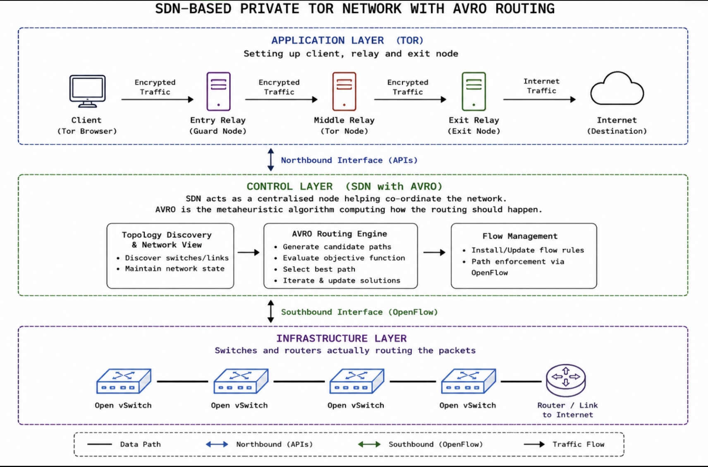

# System Architecture

Understand the three-tier design separating anonymous overlay routing, centralized SDN path optimization, and packet-level data forwarding.

---

## 1. Overview

The system decouples network intelligence from packet forwarding and cryptographic overlay routing across three distinct architectural layers:

* **Application Layer (Tor Network):** Manages multi-hop onion encryption and circuit construction across isolated Tor nodes.
* **Control Layer (SDN Controller with AVRO):** Acts as the centralized network brain, computing optimal layer-3 paths via the `MiniAVOA` metaheuristic engine.
* **Infrastructure Layer (Data Plane):** Executes high-speed packet switching across Open vSwitch (OVS) instances and virtual network links.

---

## 2. Architecture Diagram

> **Conceptual Diagram vs. Deployed Testbed:**  
> This diagram is a **logical representation** of the SDN-Tor architecture rather than a literal mapping of the deployed container topology:
> * **Overlay Nodes:** The conceptual diagram illustrates a standard three-relay public Tor circuit (Entry, Middle, Exit). In the actual deployed testbed (`topo.py`), the private overlay comprises four Docker containers: one client (`tor_cli`), two relays (`tor_relay`, `tor_relay2`), and one private directory authority (`tor_hsdir`).
> * **External Connectivity:** The "Internet (Destination)" cloud represents the conceptual egress endpoint of standard Tor architecture. In this experimental setup, the network is strictly isolated and air-gapped with no external Internet routing.

---

## 3. Application Layer – Tor

The application layer operates as a private, isolated onion-routing overlay running inside containerized environments. It handles end-to-end cell encryption without visibility into the underlying switch topology.

In conceptual Tor architecture, traffic traverses four logical roles:

* **Client:** Initiates communication through the Tor network via a local SOCKS proxy interface (`SOCKSPort 9050`), wrapping outgoing payloads in multiple layers of encryption.
* **Entry Relay (Guard Node):** Serves as the first hop in a standard Tor circuit, receiving encrypted traffic directly from the client and stripping the outermost encryption layer.
* **Middle Relay (Tor Node):** Forwards encrypted cells between relays without knowing both the origin and final destination.
* **Exit Relay (Exit Node):** Decrypts the final Tor encryption layer and forwards traffic toward its destination endpoint. *(In the isolated testbed, traffic remains confined within the private virtual subnet rather than exiting to the public Internet.)*

---

## 4. Control Layer – SDN with AVRO

The control layer centralizes network coordination using the **OSKen** SDN framework paired with the **AVRO (`MiniAVOA`)** optimization engine. Instead of relying on static shortest-path metrics, the controller dynamically evaluates candidate routes across the switch fabric.

The control plane operates through three sequential modules:

### A. Topology Discovery and Network View
* **Discover Switches and Links:** Listens for OpenFlow `EventOFPSwitchFeatures` handshakes and Link Layer Discovery Protocol (LLDP) events to map active datapaths and inter-switch ports.
* **Maintain Network State:** Constructs and updates a live graph representation of the Spine-Leaf topology using `NetworkX`.

### B. AVRO Routing Engine
* **Generate Candidate Paths:** Initializes a population of candidate edge-weight vectors across all discovered network links.
* **Evaluate Objective Function:** Scores each candidate vector using statistical uniformity (minimizing link weight mean and standard deviation) to prevent link saturation.
* **Select Best Path:** Maps the highest-scoring weight vector onto the topology graph and resolves the optimal hop-by-hop sequence via Dijkstra's algorithm.
* **Iterate and Update Solutions:** Alternates between global exploration and local exploitation across epochs to refine routing paths dynamically.

### C. Flow Management
* **Install and Update Flow Rules:** Translates computed switch paths into OpenFlow 1.3 `OFPFlowMod` messages.
* **Path Enforcement via OpenFlow:** Pushes match-action rules directly to the flow tables of every switch along the selected path.

---

## 5. Infrastructure Layer

The infrastructure layer forms the underlying data plane responsible for raw packet forwarding. Switches in this layer contain no routing intelligence of their own and forward frames strictly according to rules installed by the control plane.

It consists of:

* **Open vSwitch (OVS) Instances:** Virtual OpenFlow 1.3 switches arranged in a Spine-Leaf fabric (`s1`–`s3` spine switches, `s4`–`s7` leaf switches) that match incoming packet headers against local flow tables.
* **Interconnected Network Links:** Virtual Ethernet (`veth`) pairs and traffic-controlled links (`TCLink`) providing full-mesh connectivity between spine and leaf layers.
* **Gateway / External Interface:** Logical egress gateway (`172.18.0.254`) configured on the container interfaces; remains isolated within the local testbed unless explicit host NAT/routing is enabled.

---

## 6. Communication Between Layers

Interactions across the three tiers are strictly isolated through standardized interfaces:

* **Northbound Interface (APIs):** Connects the Application Layer to the Control Layer. Enables high-level network applications, telemetry collectors, or policy modules to query topology state or submit routing requirements to the SDN controller without interacting with switch hardware.
* **Southbound Interface (OpenFlow 1.3):** Connects the Control Layer to the Infrastructure Layer over out-of-band TCP channels (`127.0.0.1:6633` / `6653`). Used by the switches to send `PacketIn` alerts for unknown flows, and by the OSKen controller to push `FlowMod` forwarding instructions down to the OVS data plane.

---

## 7. Related Documentation

* [Routing Methodology](routing-methodology.md)
* [Modify the Network Topology](../how-to/change_topology.md)
* [Launch SDN Controller](../how-to/launch-controller.md)
* [Run Private Tor Network](../how-to/run-tor-network.md)

