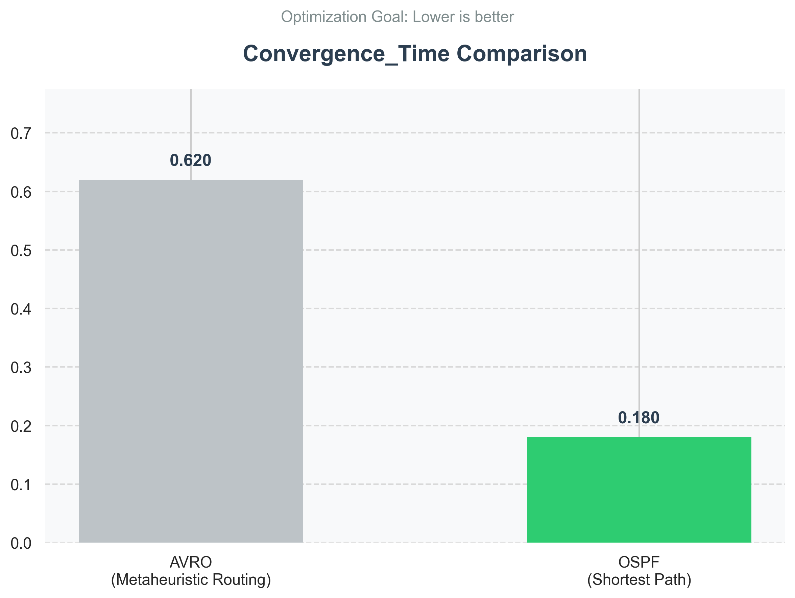
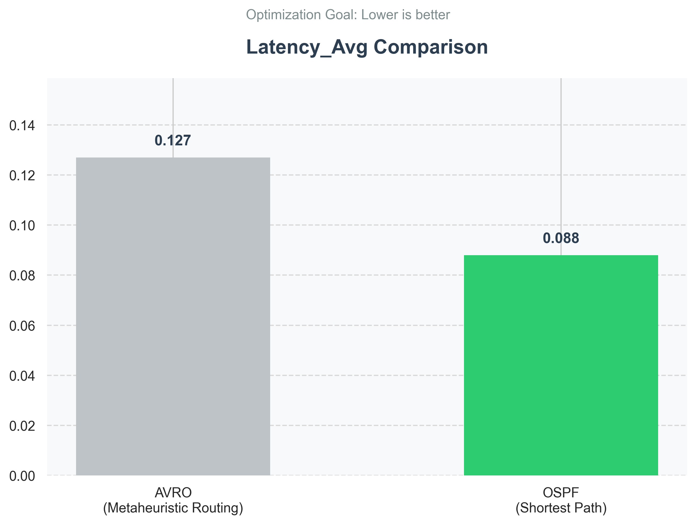
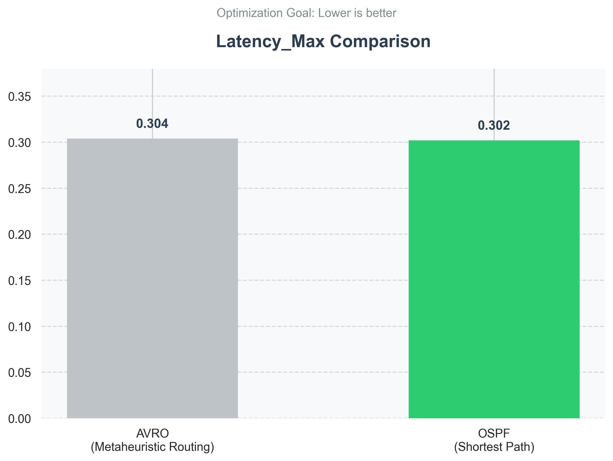
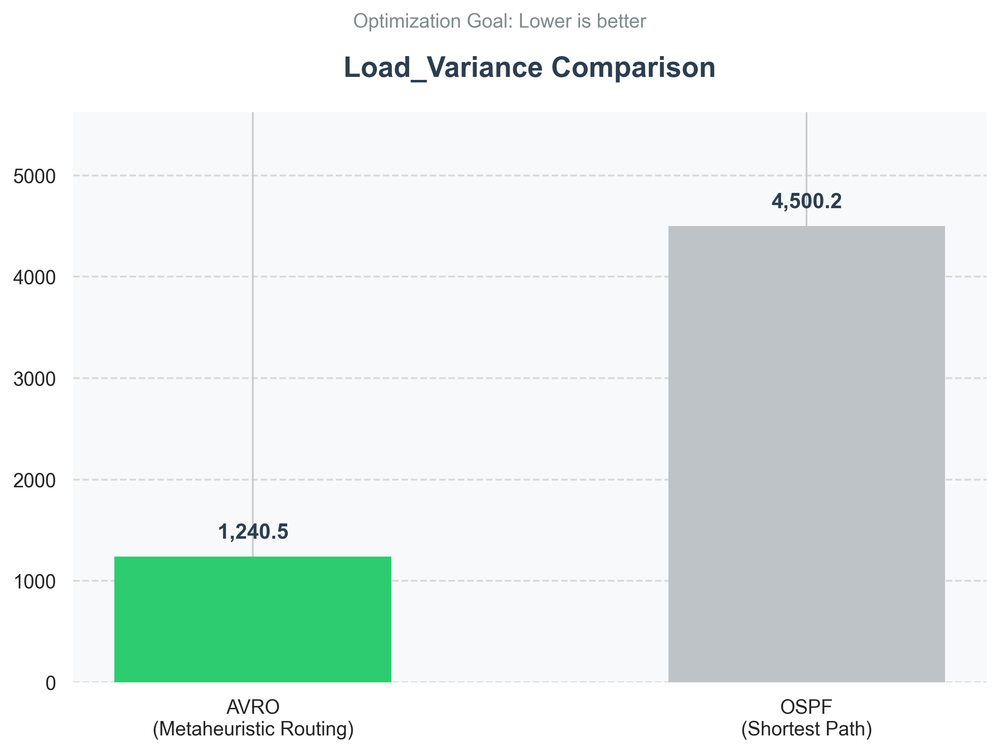
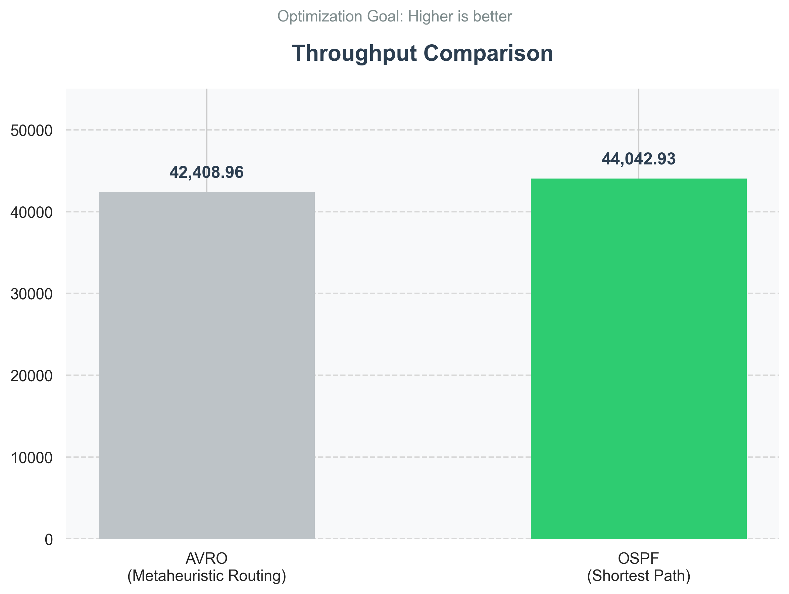

# Performance Evaluation

Compare the `MiniAVOA` (AVRO) SDN routing engine against an OSPF shortest-path baseline across network-level and Tor application-level metrics.

---

## 1. Overview

Evaluate how underlay routing affects packet forwarding and Tor consensus transfers inside the isolated testbed. Compare two routing strategies under identical test conditions:

* **AVRO (`MiniAVOA`):** Generates candidate edge weights, applies them to the `NetworkX` graph, and resolves minimum-total-weight paths via Dijkstra's algorithm.
* **OSPF Baseline:** Computes conventional shortest-path routes across the switch fabric.

---

## 2. Experimental Environment

Evaluation spans two distinct experimental scopes:

* **Underlay Routing Benchmark (Dragonfly Topology):** Compares AVRO (`MiniAVOA`) against an OSPF shortest-path baseline over uncapped virtual Open vSwitch links. *(Note: Benchmarks were originally executed across multiple topologies; `final_result_dragon.csv` is the surviving dataset retained after repository cleanup.)*
* **Tor Overlay Testbed (Spine-Leaf Topology):** Runs four isolated Tor Docker containers (`tor_cli`, `tor_relay`, `tor_relay2`, `tor_hsdir`) across 7 OVS switches (`s1`–`s3` Spine, `s4`–`s7` Leaf) with `10 Mbps` / `10 ms` `TCLink` constraints for application-level SOCKS5 measurements (`data_gatharing.py`).

---

## 3. Measurement Methodology

### 3.1 Network-Level Measurements
Collect and plot seven underlay metrics for both AVRO and OSPF using Python:

| Metric | Unit | Purpose |
| :--- | :--- | :--- |
| **Convergence Time** | `s` | Measure time required for routing tables to stabilize |
| **Average Latency** | `ms` | Measure mean end-to-end communication delay |
| **Maximum Latency** | `ms` | Capture peak observed communication delay |
| **Load Variance** | `Score` | Measure dispersion in reported network load |
| **Retransmissions** | `Packets` | Count TCP packet retransmission events |
| **Throughput** | `Mbps` | Measure data volume transferred over time |

### 3.2 Tor Application-Level Measurements
Execute `data_gatharing.py` to run a Perl SOCKS5 client inside `mn.tor_cli` against `tor_hsdir` (`172.18.0.5:9030`):

| Component | Configuration |
| :--- | :--- |
| **Tor Client / SOCKS5** | `172.18.0.10:9050` |
| **Destination / DirPort** | `172.18.0.5:9030` |
| **Requested Resource** | `/tor/status-vote/current/consensus` |
| **Trial Schedule** | `6` trials, `4`-second delay between trials |

Follow this measurement sequence per trial:

1. Open a TCP socket to `172.18.0.10:9050` and complete the SOCKS5 handshake.
2. Send a SOCKS5 `CONNECT` request to `172.18.0.5:9030` and record elapsed setup time (logged as `ttfb`, representing SOCKS5 connection establishment time).
3. Request the directory consensus, count received bytes, and record total elapsed time (defaulting to `0.5s` if integer elapsed time reads `0`).
4. Compute application-level throughput:

$$\text{Throughput (Mbps)} = \frac{\text{Received Bytes} \times 8}{\text{Total Elapsed Time} \times 10^6}$$

5. Repeat for 6 trials and write per-trial and averaged results to `tor_performance_data.csv`.

*(Note: Because `data_gatharing.py` does not issue a Tor ControlPort `NEWNYM` signal between trials, Tor reuses existing circuits by default across the 6 runs.)*

---

## 4. Experimental Results

Review the recorded underlay comparison from `final_result_dragon.csv` (Dragonfly topology, uncapped virtual links):

| Metric (Unit) | AVRO | OSPF |
| :--- | :---: | :---: |
| **Convergence Time (`s`)** | `0.620` | `0.180` |
| **Average Latency (`ms`)** | `0.127` | `0.088` |
| **Maximum Latency (`ms`)** | `0.304` | `0.302` |
| **Load Variance (`Score`)** | `1,240.5` | `4,500.2` |
| **Retransmissions (`Packets`)** | `842` | `2,706` |
| **Throughput (`Mbps`)** | `42,408.96` | `44,042.93` |

*(Note: `Load Variance` is reported as a relative benchmark `Score` from the evaluation script rather than a physical link-utilization percentage.)*

### 4.1 Convergence Time
OSPF converged faster (`0.180 s`) than AVRO (`0.620 s`).

### 4.2 Latency
OSPF recorded lower average latency (`0.088 ms` vs `0.127 ms`), while maximum latency remained nearly identical (`0.302 ms` vs `0.304 ms`).

### 4.3 Load Variance
AVRO recorded substantially lower measured load variance (`1,240.5`) compared to OSPF (`4,500.2`).

### 4.5 Throughput
OSPF achieved higher measured throughput (`44,042.93 Mbps`) than AVRO (`42,408.96 Mbps`).

### 4.6 Tor Application-Level Consensus Transfer
Execute `data_gatharing.py` across a 6-trial run (`tor_performance_data.csv`) to measure SOCKS5 connection setup (`ttfb`) and directory consensus download throughput between `tor_cli` (`172.18.0.10:9050`) and `tor_hsdir` (`172.18.0.5:9030`):

| Trial | TTFB (`s`) | Throughput (`Mbps`) |
| :---: | :---: | :---: |
| `1` | `0.0` | `0.045824` |
| `2` | `0.0` | `0.045472` |
| `3` | `0.0` | `0.022912` |
| `4` | `0.0` | `0.045824` |
| `5` | `0.0` | `0.022912` |
| `6` | `0.0` | `0.045472` |
| **Average** | **`0.0`** | **`0.038069`** |

*(Note: The 6-trial run produced a mean throughput of `0.038069 Mbps` [`38.07 Kbps`], median `0.045472 Mbps`, and standard deviation `0.011742 Mbps`. Values alternate between `~0.0458 Mbps` and `~0.0229 Mbps` because Perl's integer `time()` rounds sub-second transfers of the `~2.85 KB` private consensus to `0 s` [triggering the script's `0.5 s` fallback denominator] or `1 s` when crossing a wall-clock second boundary.)*

---

## 5. Interpretation of Results

Observe the performance trade-offs rather than a universal winner:

* **AVRO Strengths:** Recorded lower measured load variance (`1,240.5` vs `4,500.2`) and fewer retransmissions (`842` vs `2,706` packets).
* **OSPF Strengths:** Achieved faster convergence (`0.180 s` vs `0.620 s`), lower average latency (`0.088 ms` vs `0.127 ms`), and higher throughput (`44,042.93 Mbps` vs `42,408.96 Mbps`).
* **Parity:** Both configurations maintained `0.0%` packet loss and nearly identical peak latency (`0.304 ms` vs `0.302 ms`).

Metaheuristic edge-weight generation introduces control-plane computation time and does not automatically outperform conventional shortest-path routing across every metric.

---

## 6. Limitations

Account for these experimental constraints when interpreting the data:

* **Topology & Link-Cap Scope:** The plotted underlay metrics originate from an uncapped Dragonfly benchmark (`final_result_dragon.csv`) rather than the rate-limited (`10 Mbps`, `10 ms`) Spine-Leaf Tor topology in `topo.py`. Additional topology datasets from the original multi-topology run were removed during repository cleanup.
* **Relative Load Variance Metric:** `Load_Variance` is logged as an abstract `Score` without a documented physical unit.
* **Simplified Metaheuristic:** `MiniAVOA` implements a condensed AVOA-inspired solver rather than the complete published algorithm.
* **Synthetic Fitness Function:** Candidate weights are scored statistically ($\sigma + \mu$) without ingesting live OpenFlow port utilization or congestion counters.
* **Coarse Timer Resolution:** `data_gatharing.py` relies on Perl's integer `time()` function (1-second resolution) over 6 trials without forcing circuit rebuilds between runs.
* **No Anonymity Claims:** Underlay performance metrics do not demonstrate improved Tor anonymity or traffic-analysis resistance.

---

## 7. Conclusion

Implement and benchmark `MiniAVOA` against OSPF inside the isolated SDN-Tor testbed to highlight clear routing trade-offs: AVRO reduced measured load variance and retransmissions, while OSPF delivered faster convergence, lower latency, and higher throughput.

---

## 8. Related Documentation

* [System Architecture](architecture.md)
* [Routing Methodology](routing-methodology.md)
* [Tor Integration](tor-integration.md)
