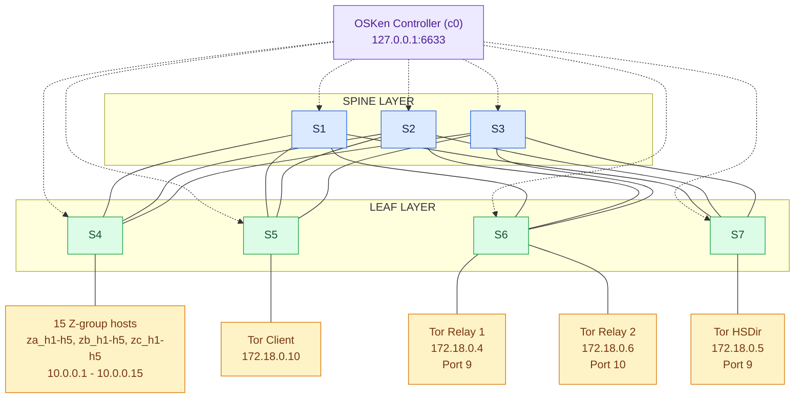

# Modify the Network Topology

Inspect, customize, and scale the Spine-Leaf Containernet topology defined in `topo.py`.

---

## 1. Overview

Extend or modify the emulated SDN-Tor testbed by editing `topo.py` to add Open vSwitch (OVS) instances, attach Dockerized Tor nodes or standard Mininet hosts, configure link metrics, and manage dual-subnet IP assignments.

---

## 2. Understanding the Existing Topology

The baseline deployment implements a **Spine-Leaf Clos architecture** managed centrally by a single remote controller:

* **Switches (7 Total):** 3 Spine switches (`s1`–`s3`) and 4 Leaf switches (`s4`–`s7`).
* **Hosts & Tor Nodes (19 Total):** 
  * **15 Standard Mininet Hosts:** Named `za_h1`–`za_h5`, `zb_h1`–`zb_h5`, and `zc_h1`–`zc_h5`, attached to `s4`.
  * **4 Dockerized Tor Nodes:** `tor_cli` (on `s5`), `tor_relay` and `tor_relay2` (on `s6`), and `tor_hsdir` (on `s7`).
* **Switch Interconnections:** Every Leaf switch (`s4`–`s7`) connects directly to every Spine switch (`s1`–`s3`) in a full-mesh bipartite fabric (12 inter-switch links total, each configured with `10ms` delay and `10 Mbps` bandwidth).
* **Controller Binding:** All 7 switches connect out-of-band via OpenFlow to `RemoteController` (`c0`) listening at `127.0.0.1:6633`.

### Topology Diagram

### 3. Locating Topology Definitions

Open topo.py in your editor to inspect the network construction inside setup_network():

```Bash

nano topo.py
```
Key code blocks inside setup_network():

* Controller Setup: net.addController('c0', ...)

* Switch Instantiation: s1 = net.addSwitch('s1') through s7

* Tor Container Definitions: net.addDocker(...) calls for tor_cli, tor_relay, tor_relay2, and tor_hsdir

* Fabric & Edge Links: net.addLink(...) loops connecting leaves to spines and nodes to leaves

* IP Re-assignment Loop: tor_configs list applying 172.18.0.x/16 addresses after net.start()

### 4. Modifying Nodes and Switches

Follow this workflow to expand the topology—for example, adding a fifth leaf switch (s8) and a third relay (tor_relay3):
1. Define the Additional Switch

Locate the switch block in topo.py and instantiate s8:

```Python

s7 = net.addSwitch('s7')
s8 = net.addSwitch('s8')  # New leaf switch
```
2. Assign Containers or Hosts

Add the new Dockerized Tor container (mounting its corresponding config directory) or a standard Mininet host:

```Python

tor_relay3 = net.addDocker(
    'tor_relay3',
    ip='10.0.0.20/8',
    dimage="antitree/private-tor:latest",
    network_mode='none',
    volumes=["/absolute/path/to/Sdn_tor_avro/configs/relay3:/etc/tor:rw"]
)
```
(Subsitute /absolute/path/to/Sdn_tor_avro/configs/relay3  on your host before running.)
### 5. Configuring Network Links
1. Connect the New Switch to the Spine Layer

Add s8 to the leaf-to-spine mesh loop so all three spine switches (s1–s3) maintain full connectivity:

```Python

for leaf in [s4, s5, s6, s7, s8]:
    for spine in [s1, s2, s3]:
        net.addLink(leaf, spine, cls=TCLink, delay='10ms', bw=10)
```
2. Attach the Node to the Leaf Switch

Link the new container to s8 using an explicit switch port number (port2=9) to keep interface numbering predictable:

```Python

net.addLink(tor_relay3, s8, port2=9)
```
### 6. Updating IP Addressing

topo.py uses two distinct IP ranges:

* Standard Hosts (10.0.0.1/8 – 10.0.0.15/8): Assigned directly during net.addHost().

* Tor Containers (172.18.0.0/16): Assigned post-startup inside the tor_configs wipe loop. Containernet initializes Docker nodes with 10.0.0.x/8 placeholders, then flushes eth0 and binds 172.18.0.x/16 so Tor descriptors match torrc settings.

* These are seperate addressing conventions in the implementatio, not necessarily two independent routed networks.
Register the new container in tor_configs right after net.start():

```Python

tor_configs = [
    ('tor_cli', '172.18.0.10/16', '172.18.0.254'),
    ('tor_relay', '172.18.0.4/16', '172.18.0.254'),
    ('tor_relay2', '172.18.0.6/16', '172.18.0.254'),
    ('tor_hsdir', '172.18.0.5/16', '172.18.0.254'),
    ('tor_relay3', '172.18.0.7/16', '172.18.0.254')  # New Tor node IP
]
```
(Note: Ensure super_controller.py dynamically discovers datapath IDs via EventOFPSwitchFeatures rather than hardcoding switch counts, allowing s8 to register automatically.)
### 7. Running the Modified Topology
1. Start the SDN Controller

Ensure super_controller.py is running in Terminal 1 before starting the network:
```Bash

osken-manager --verbose super_controller.py
```
2. Deploy the Updated Topology

Launch topo.py in Terminal 2:
```Bash

sudo python3 topo.py
```
Verification: Look at Terminal 1 to confirm s8 (datapath_id=8) completes the OpenFlow handshake:
```text

switch features ev version=0x4,msg_type=0x6,msg_len=0x20,xid=0x...,OFPSwitchFeatures(auxiliary_id=0,capabilities=79,datapath_id=8,n_buffers=0,n_tables=254)
```
### 8. Verifying Connectivity

Run these checks from the containernet> CLI prompt to validate your new links and IP bindings:
1. Inspect Switch Links and Ports

Verify s8 is wired to s1, s2, s3, and tor_relay3:
```text

containernet> net
```
Expected output includes:
```text

tor_cli tor_cli-eth0:s5-eth9
tor_relay tor_relay-eth0:s6-eth9
tor_relay2 tor_relay2-eth0:s6-eth10
tor_hsdir tor_hsdir-eth0:s7-eth9

```
2. Verify Container Interface IP

Confirm tor_relay3 flushed its 10.0.0.x placeholder and bound 172.18.0.7/16:

```text

containernet> tor_relay3 cat /proc/net/fib_trie
```

3. Test End-to-End Reachability

Ping from the Tor client to the new relay across the Spine-Leaf fabric:
```text

containernet> tor_cli ping -c 3 172.18.0.7
```
Verification: Confirm 0% packet loss and check Terminal 1 to verify MiniAVOA computed a route passing through switch 8.
### 9. Common Configuration Errors

* RTNETLINK answers: File exists or Port already in use:

* Two links were assigned the same explicit port number on a switch (e.g., assigning port2=9 twice on s6). Increment port2 for each additional attachment on the same switch.

* Tor Daemon Exits Immediately (Permissions on directory /etc/tor/keys are too open):

* Host volume directories created by your regular user (uid=1000) are rejected by Tor running as root inside the container. Add the new node's keys/ path to fix_host_key_ownership() at the top of topo.py.

* Unreachable 172.18.0.x IP Between Containers:

* Ensure the new container is added to tor_configs with the /16 subnet mask. Missing an entry leaves the node on 10.0.0.x/8, isolating it from the 172.18.0.0/16 Tor overlay.

* Leftover Interfaces After Crash (Exception: Error creating interface pair):

Clean residual virtual links before re-running topo.py:
```Bash

    sudo mn -c
```
